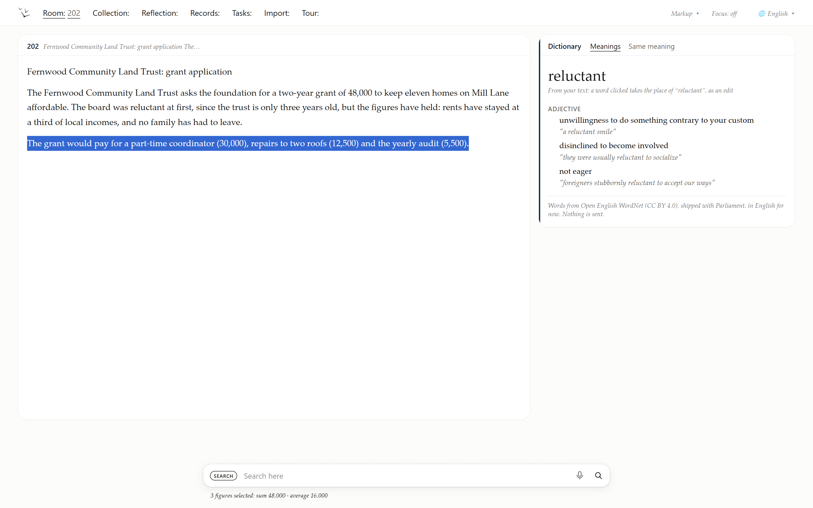
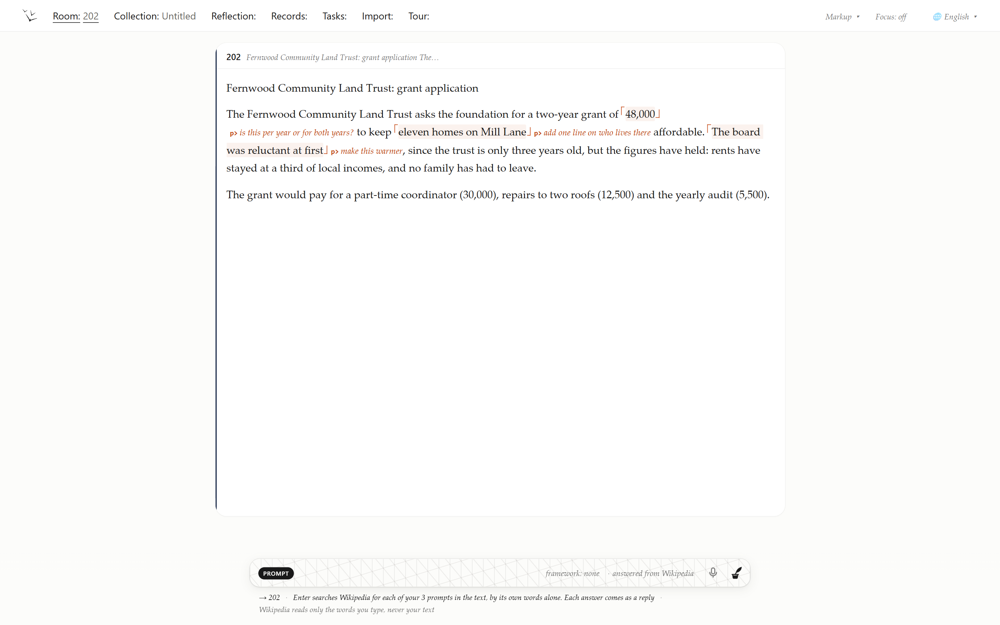
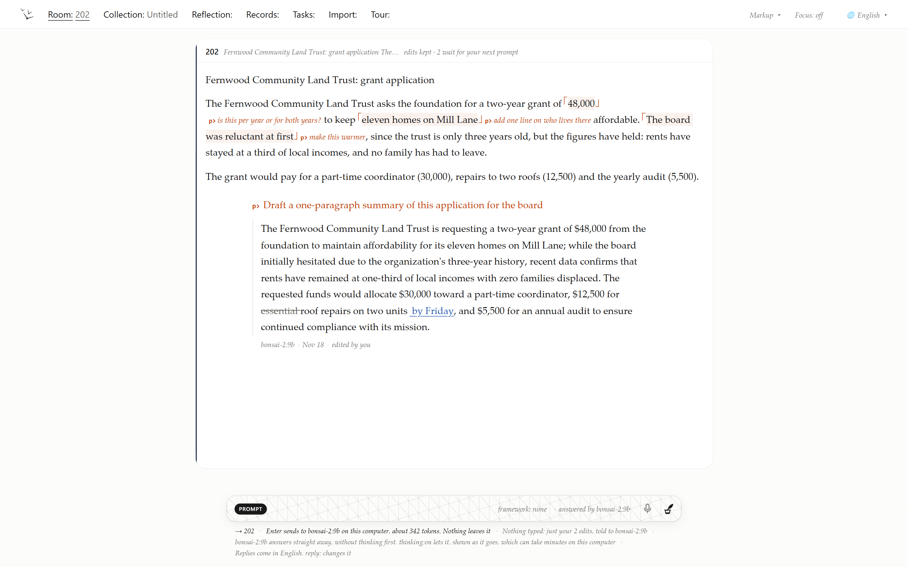
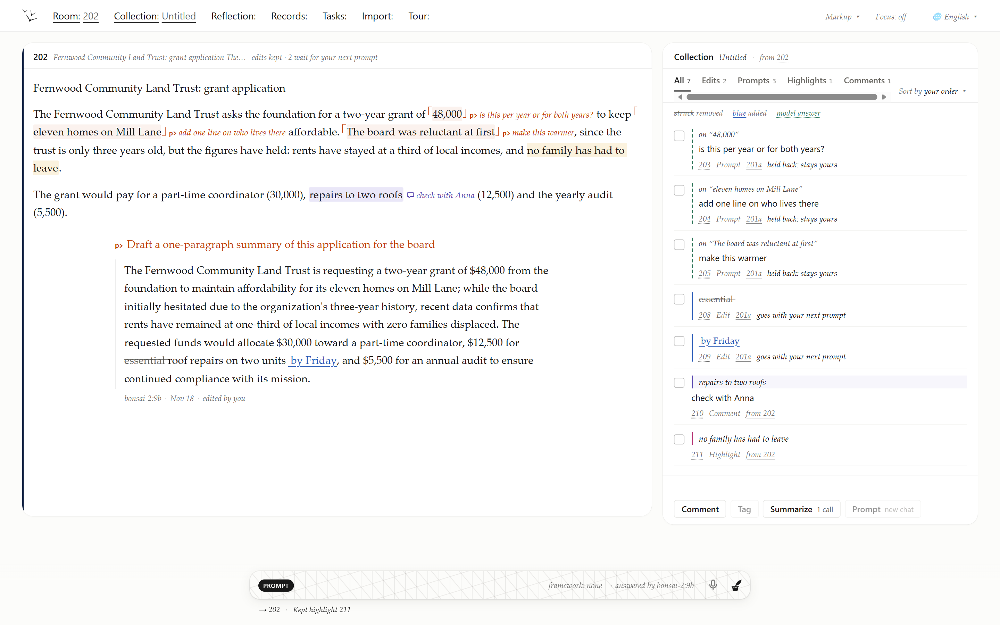
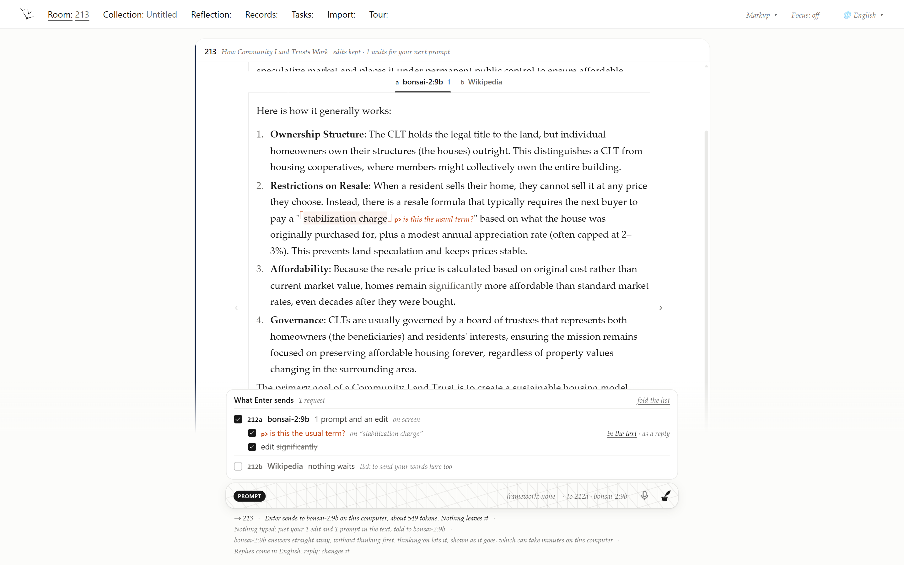
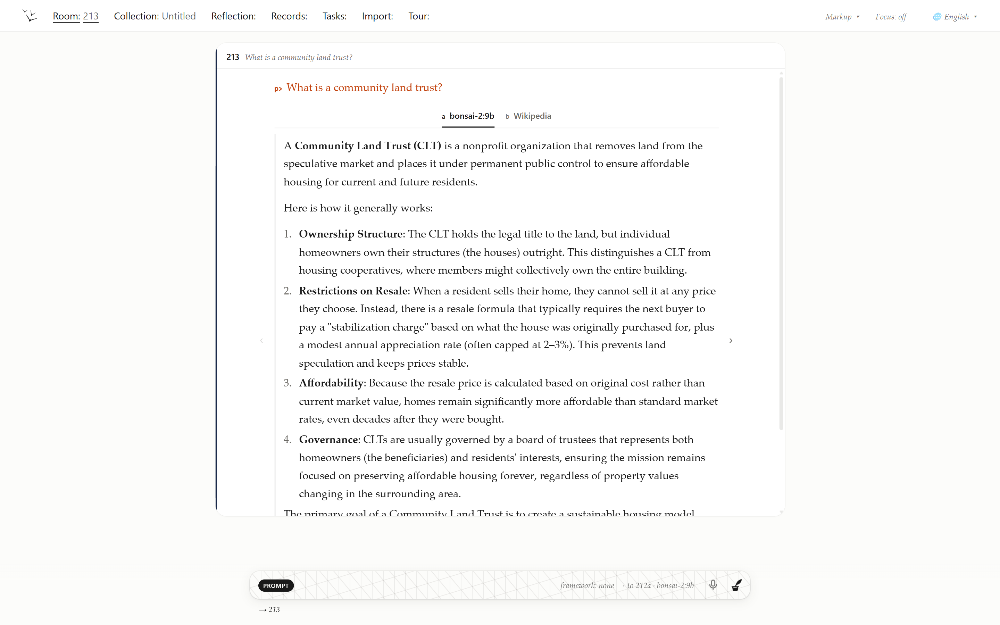
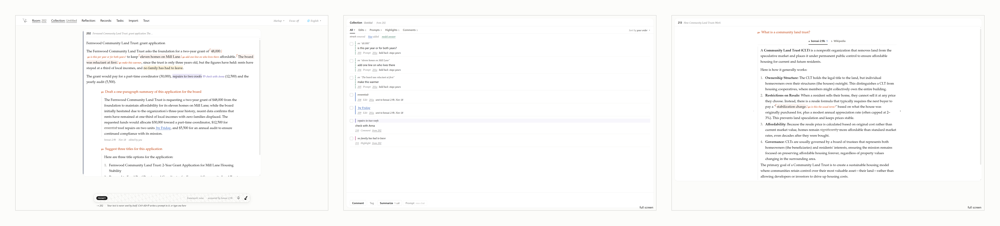
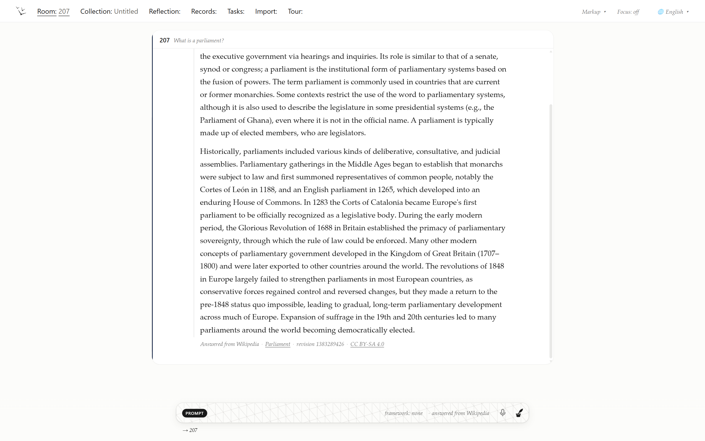
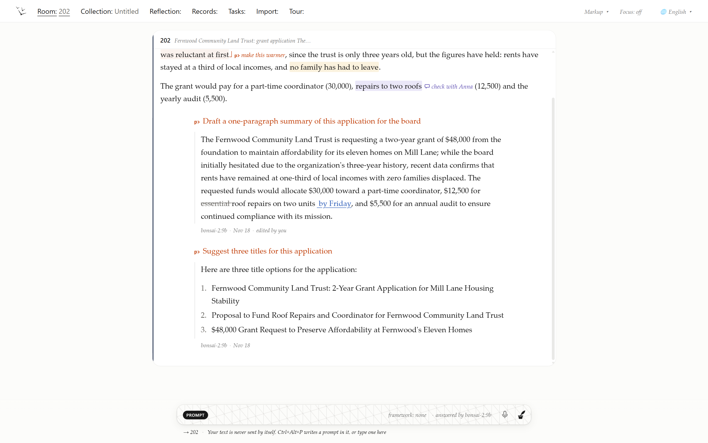

# Parliament

Parliament is an attempt to rethink how we interact with AI.

Parliament runs in your browser. There is no backend and no account. You
bring your own keys, or run a model on your own machine. What you write stays
on your device until you press Enter. Then it goes straight to the provider or
source you chose, and nowhere else. What leaves your device, and when, is
listed in full [below](#what-leaves-your-device).

**Status: beta.** Parliament works today at
[parliament.ltd](https://www.parliament.ltd) and changes often.
[CHANGELOG.md](CHANGELOG.md) says what each version changed.

## What you can do with it

Most AI tools have you ask, then read what comes back. Parliament is built so
you take part: you write, you decide what a model sees, and you change what it
says.

### Write, with or without AI

A room is one page of text. Write in it as you would anywhere else: no prompt
is needed, and nothing is sent. Your writing, the prompts you sent and the
replies are one text, to select across, type over and delete. Your own words
simply go until a model has read them; after that, and in prompts and
replies, what you delete is struck, and goes to the model as an edit. When you
send a prompt, the model reads your writing with it.

The writing tools need no model:

- **Dictionary:** `dictionary:reluctant`, or select a word and press
  Ctrl+Alt+L.
- **Sums:** `calc:48000*2/12`, or select figures to see their sum and average.
- **Alarms:** `alarm:25m tea`, or `alarm:every 50m "Take a break"`.



### Prompt inside your text, several at once

A prompt does not have to go in the bar. Select words anywhere and press
Ctrl+Alt+P: in your own writing, in a reply, or in a prompt you already sent.
Your prompt sits in the line, after the words it is about. Leave as many as
you like, then send them together with one Enter, to whoever the bar sends
to. With a source such as Wikipedia, each is searched by its own words and
answered under the text, with no model and no key.



### Change a reply instead of asking again

A reply sits in your text as a quote, with who answered under it. Strike its
words or add your own, and it reads "edited by you" from then on. Your edits
go with your next prompt. Comments are for you, and are never sent.



### Gather your thinking in the Collection

Everything you mark comes together on one board: your highlights, comments
and edits, and the prompts you left in the text, each saying where it came
from. Sort them, work from what you kept, and send the prompts that wait from
there.



### Decide what goes before it goes

The line under the bar names who will be asked before you press Enter. When
prompts in the text or edits are waiting, it opens a list of what Enter
sends. Untick one to hold it back. Nothing leaves your device until you press
Enter.



### Ask several at once

`by:haiku, wikipedia` sends one prompt to each, and their answers sit side by
side as branches of the chat. `compare:201a 201b` sets two answers next to
each other and marks the words that differ, with no model.



### Lay your work out across your screens

Everything on screen is a board, and you decide where each one goes. Put
boards side by side and set their widths. Pop one into a window of its own.
Parliament can tell when another screen is attached, so a board can be sent to
one by number, or `spread:` can share out everything open across all of them.

- `open:202 203 records` opens two rooms and your records together.
- `move:collection display 3` sends the Collection to your third screen.
- `width:collection 30%` sets how much room a board takes.
- `arrange:save "Review desk"` keeps the whole layout, windows included, and
  `arrange:"Review desk"` brings it back.

Some ways to set it up:

- **Several chats at once.** A room on each screen, each with its own model,
  and the Collection between them.
- **Reading and taking notes.** Papers found through OpenAlex on one screen,
  your own writing on the next, and the dictionary beside it.
- **One screen, kept simple.** `focus:` closes every board but the room you
  are in, and `focus:off` brings back what it closed.

Placing windows on other screens needs a browser that allows it, and asks
your permission first. [Browsers](docs/spec/browsers.md) says what works
where.



### Ask a source with no AI at all

Type `p>` and a question. With no key saved, the answer comes from Wikipedia,
with no key and no model; with one, `by:wikipedia` asks it instead. Hacker
News and OpenAlex work the same way.



### Use a model on your own computer

A model that runs on your machine answers without your prompt leaving it.
Settings walks you through setting one up:

1. Install Ollama and open it.
2. Add a model, for example `ollama pull llama3.2`.
3. Let it answer this site, and only this site, with the line Settings gives
   you.
4. Open Ollama again, then press check.



## How it is put together

- **Boards.** Everything on screen is a board: Records (everything you have
  made, by number), the Collection, Tasks, Reflection, Settings, and every
  room.
- **The bar.** One field, read three ways: search, `>` for a command, `p>` for
  a prompt. The line under it says what Enter will do before you press it.
  [Every command](docs/verbs.md).
- **Rooms.** A room is a board built around a conversation, kept as one text:
  a prompt you sent is a `p>` line, and a reply is a quote.

## Works now, and next

Parliament is in beta. This is what works today:

- Writing, the dictionary, sums and alarms, with no model.
- Prompts in the text, edits to replies, and the Collection.
- Wikipedia, Hacker News and OpenAlex, with no key.
- A model on your own computer.
- Boards side by side, in their own windows, across your screens, and in
  saved arrangements.

This is what comes next:

- **The Lab.** Build your own rooms from blocks, a layout and a theme.
- **Reflection.** A board for looking back at your own work: what you
  changed, what you kept, and what that says about your thinking.
- **Tasks.** On the site today, and still being reworked: planning work as
  steps, some yours and some a model's.
- **Offline, carried with you.** Parliament and a model on a USB drive, with
  an offline Wikipedia beside it.
- **Privacy browsers.** Tested support for Firefox, LibreWolf and Zen.
  LibreWolf deletes a site's data on closing, so your work needs somewhere
  safe to live.
- **Phones.** A layout built around voice and swiping, and a way to work
  privately offline where a USB drive is no help.

## Your work stays in your browser

Everything you make is kept in this browser, on this device. There is no copy
on a server, so `backup:` writes it all to one file for you to keep, and Lock
Parliament, in Settings, encrypts what is kept here.

## What leaves your device

- **Your prompt.** When you press Enter, your prompt, the conversation it
  continues and anything you attached go straight from your browser to the
  provider or source named on the line under the bar. Nowhere else.
- **Your writing, with a prompt.** The first time a model reads a room, your
  own writing and your edits go with the prompt. Comments never go. A source
  such as Wikipedia receives only the words you typed.
- **A model on your own machine.** If that is what you chose, the prompt goes
  no further than your computer.
- **Your key.** The key for a provider travels with the request, to that
  provider only. A model on your own machine and a source such as Wikipedia
  get no key.
- **A key check.** Saving or checking a key sends one very small test request
  to that provider.
- **A name for a new chat.** After the first answer in a new chat, one small
  request asks a model for a title, a summary and tags. The line under the bar
  says so before you send, and Settings can turn it off.
- **Web search, if you switch it on.** The provider runs the searches on its
  side, so search terms drawn from your chat reach the search service it uses.
- **Voice, if you use it.** Speech is turned into text on this device. No
  audio leaves it. Where a browser can only do this by sending audio to its
  maker, Parliament does not offer voice.
- **The app itself.** Your browser fetches Parliament's files, its updates
  and the dictionary's word lists from `parliament.ltd` and
  `keys.parliament.ltd`, hosted by Netlify. Like any web host it sees your IP
  address and browser type. It never receives your chats or keys.
- **Nothing else.** No analytics, no tracking, no advertising, and no code
  loaded from any other site. Settings, under About, lists every host this tab
  has reached.

## Your keys

Each key is kept by Parliament's key vault, a small page of its own at
`keys.parliament.ltd`, encrypted, and is sent only to its own provider. Code
running on Parliament's page cannot read a key; it can only ask the vault to
send to a provider on the vault's own list. See [SECURITY.md](SECURITY.md).

## Who it can talk to

Every provider and source is listed in Settings, and in the published policy,
before it can be used.

- Providers that take a key: Anthropic, Mistral.
- A model on your own machine: Ollama, on `localhost:11434`.
- Sources with no key: Wikipedia, Hacker News (through Algolia), OpenAlex.

## Running it on your own computer

```bash
npm install
npm run dev          # the app, on localhost:5173
npm run dev:vault    # the key vault, on localhost:5175, beside it
npm run check        # tests, lint, and both builds
npm run reference    # rewrites docs/verbs.md and SECURITY.md's policy block
node scripts/policy-trial.mjs   # both builds under the real headers, on 4173 and 5176
```

## More

- [Every command](docs/verbs.md), written from the command registry.
- [SECURITY.md](SECURITY.md): how Parliament is built to keep your work yours,
  and how to report a vulnerability.
- [Browsers](docs/spec/browsers.md): what works where. Settings, About, says
  what works in the browser you are using.
- [CHANGELOG.md](CHANGELOG.md): what each version changed.
- [CLAUDE.md](CLAUDE.md) and [docs/spec/](docs/spec/): the design record and
  its rulings. [refactor/](refactor/) explains how the code got here.

## Licence

MIT. See [LICENSE](LICENSE).

The Dictionary board's word lists (`public/words/en/`) are shortened from
Open English WordNet, under CC BY 4.0 and the WordNet License. Their notice
is in [public/words/en/LICENSE.txt](public/words/en/LICENSE.txt).
